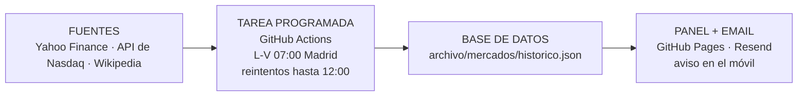

# Mercados Diarios

Reporte y panel diario de los cierres de **IBEX 35, Euro Stoxx 50, S&P 500, Nasdaq 100 y MSCI World**.
Funciona solo, en la nube, sin tener el ordenador encendido.

**Panel web:** https://mglciudad-sketch.github.io/mercados-diarios/

---

## Qué hace

Cada día laborable a las **07:00 (hora de Madrid)**, antes de que abra la bolsa europea (con reintentos automáticos hasta las 12:00, ver más abajo):

1. **Descarga los datos** del cierre del día anterior.
2. **Calcula** para cada índice el nivel de cierre, la variación del día y los 3 valores que más suben y más bajan.
3. **Envía un email** con el reporte (en español, sin tecnicismos y con el botón "Ver panel completo").
4. **Actualiza el panel web** con el último cierre y el histórico.
5. **Guarda el reporte** en este repositorio (`archivo/mercados/`), que hace de base de datos.

Si algo falla, llega un email de aviso con el enlace al error.



Está inspirado en el "Barómetro de Mercado" del Máster de IA aplicada (track 4, clase 3.3): fuentes → tarea programada → base de datos → panel y resumen.

---

## Reglas de diseño

| Regla | Cómo se cumple |
|---|---|
| **Nunca inventar un dato** | Ninguna cifra la escribe una IA: todas salen directamente de los datos descargados. Si un dato no se puede obtener, el reporte pone un **aviso** nombrando el índice y el dato que falta, y muestra el resto. |
| **Cierre, no dato intradía** | Si una fuente trae un dato de la sesión de hoy (mercado aún abierto), se descarta y se usa el último cierre, con aviso. |
| **Fuentes de respaldo** | Si la API de Nasdaq falla o trae otra fecha, el Nasdaq 100 se calcula con Yahoo. Si Wikipedia falla, se usa la última composición guardada. Si Yahoo deja un valor vacío, se reintenta uno a uno. |
| **Verificación** | La API de Nasdaq solo se usa si su fecha coincide con la del cierre del índice. |
| **Reintentos sin duplicados** | Si a las 07:00 falta algún dato o GitHub se retrasa, se reintenta cada media hora hasta las 12:00. Solo se envía **un** email al día: el primer intento que funciona; los siguientes ven que el reporte de hoy ya existe y no hacen nada. |

---

## El email

- **Asunto:** `Reporte diario de mercados — DD/MM/AAAA`
- **Remitente:** `onboarding@resend.dev` (servicio Resend)
- **Contenido:** un bloque por índice (IBEX 35, Euro Stoxx 50, S&P 500, Nasdaq 100, MSCI World) con el cierre, la variación, los 3 que más suben, los 3 que más bajan y una frase de contexto.
- Termina siempre con *"Esto es un resumen informativo, no una recomendación de inversión."* y la línea de **Fuentes**.
- En Gmail hay un filtro que lo manda a **Principal** para que el móvil avise.

---

## El panel web

| Pestaña | Qué muestra |
|---|---|
| **Hoy** | Una tarjeta por índice: cierre, variación del día / semana / mes / año, gráfico de 6 meses, valores que más suben y bajan, y un **semáforo** según la distancia a su máximo de 52 semanas. Arriba, la **amplitud** (qué parte de los valores subió) y la lectura de la sesión. |
| **Cierre por día** | Eliges cualquier fecha desde diciembre de 2015 y ves el cierre y la variación de los cinco índices. Si eliges un festivo o un fin de semana, muestra el cierre anterior. |
| **Evolución** | Comparativa de los cinco índices en 1, 3, 6 y 12 meses (gráfico con base 100 y tabla de rentabilidades). |
| **Por años** | Rentabilidad de cada año de los últimos 10, la media anual y el acumulado, con gráfico de barras. |

**Semáforo de las tarjetas** (distancia al máximo de las últimas 52 semanas):

| Etiqueta | Distancia al máximo |
|---|---|
| En máximos | menos de un 2 % |
| Cerca de máximos | 2 % – 5 % |
| Vigilancia | 5 % – 10 % |
| Corrección | 10 % – 20 % |
| Mercado bajista | más de un 20 % |

Para tenerlo como una app en el móvil: ábrelo en el navegador y elige **"Añadir a pantalla de inicio"** (en iPhone, desde el botón Compartir).

---

## Cómo se usa

Todo se hace desde la pestaña **Actions** del repositorio:
https://github.com/mglciudad-sketch/mercados-diarios/actions

| Quiero… | Cómo |
|---|---|
| **Ver si hoy ha funcionado** | En Actions, la ejecución del día aparece con ✅ (bien) o ❌ (falló). El pie del panel también dice "Actualizado el …". |
| **Lanzarlo ahora a mano** | Actions → **Mercados diarios** (izquierda) → **Run workflow** → botón verde **Run workflow**. Tarda 1-2 minutos y envía el email **siempre**, aunque ya se hubiera enviado hoy. |
| **Pausarlo** (vacaciones) | Actions → **Mercados diarios** → **⋯** (arriba a la derecha) → **Disable workflow**. Para reactivarlo: **Enable workflow**. |
| **Cambiar hora, índices o formato** | Pedírselo a Claude Code indicando este repositorio. |

Ya **no aparece** en "Tareas programadas" de Claude: no lo ejecuta Claude, lo ejecuta GitHub.

---

## Si no llega el email

1. Antes de las 12:00 puede que aún esté reintentando: espera al siguiente intento (cada media hora).
2. Mira en **Actions** las ejecuciones de hoy.
   - Alguna larga (1-2 minutos) con ✅ → el email salió. Pasa al punto 3.
   - ❌ en las de las 11:30 o 12:00 → abre la ejecución para ver el error (normalmente, una fuente caída) y relánzala a mano.
   - No hay ejecuciones de hoy → GitHub tiene una incidencia; míralo en https://www.githubstatus.com y lánzalo a mano.
3. En Gmail busca `from:onboarding@resend.dev` en **Todos**, **Spam**, **Notificaciones** y **Papelera**.
4. Si el problema es de **Resend** (por ejemplo, una clave caducada), crea una clave nueva en https://resend.com → **API Keys** y sustitúyela en **Settings → Secrets and variables → Actions → `RESEND_API_KEY`**.

### Cómo funcionan el horario y los reintentos

| Hora (Madrid) | Qué hace cada intento |
|---|---|
| 07:00 – 11:00 | Si el reporte de hoy ya se envió, no hace nada. Si no, lo genera y **solo lo envía si están todos los datos**; si falta alguno, espera al siguiente intento (media hora después). |
| 11:30 y 12:00 | Últimos intentos: si aún no se ha enviado, lo envía **con lo que haya** y avisos de lo que falte. Si fallan, llega el email de aviso de fallo. |

- En Actions verás muchas ejecuciones cada mañana; casi todas duran unos segundos porque solo comprueban que el reporte ya salió. Es normal.
- En invierno los intentos van de 07:00 a 12:00; en verano GitHub no cambia de hora y llegan hasta las 13:00 (los de más no hacen nada si ya se envió).
- GitHub puede arrancar las tareas con retraso, sobre todo si tiene incidencias ([estado de GitHub](https://www.githubstatus.com)). El 09/11/2026 una avería de GitHub Actions retrasó la ejecución de la mañana casi 10 horas; los reintentos existen para eso.
- Desde las 09:00 la bolsa europea está abierta: si el reporte sale a esa hora, IBEX y Euro Stoxx muestran el cierre del día anterior con un aviso de que se ha descartado el dato de la sesión en curso.

---

## Fuentes de datos

| Dato | Fuente |
|---|---|
| Cierres de los índices y de cada valor | [Yahoo Finance](https://finance.yahoo.com) (librería `yfinance`) |
| Variación de los valores del Nasdaq 100 | [API de Nasdaq](https://api.nasdaq.com/api/quote/list-type/nasdaq100) |
| Composición de IBEX 35, Euro Stoxx 50 y S&P 500 | Wikipedia ([IBEX 35](https://en.wikipedia.org/wiki/IBEX_35), [Euro Stoxx 50](https://en.wikipedia.org/wiki/EURO_STOXX_50), [S&P 500](https://en.wikipedia.org/wiki/List_of_S%26P_500_companies)) |

## Limitaciones conocidas

- **MSCI World:** solo cierre y variación. MSCI no publica gratis la composición diaria de sus más de 1.300 valores, así que no hay ranking de valores.
- **Ranking de valores histórico:** existe desde el **06/11/2026**, que es cuando empezó a guardarse. Para fechas anteriores solo hay datos de los índices; no se recalcula hacia atrás porque la composición de los índices cambia y daría datos falsos.
- **Rentabilidades:** variación del precio del índice, **sin dividendos**. El MSCI World está en dólares.
- **Composición:** se toma de Wikipedia cada día; si un índice cambia de composición, se refleja cuando Wikipedia lo actualiza.

---

## Archivos del repositorio

| Archivo | Para qué sirve |
|---|---|
| `.github/workflows/mercados-diarios.yml` | La tarea programada: horario, pasos y publicación del panel. |
| `scripts/reporte_mercados.py` | Descarga los datos, calcula el reporte, envía el email y guarda el histórico. |
| `scripts/panel_mercados.py` | Genera el panel web con los cierres desde 2015 y el histórico. |
| `scripts/panel_plantilla.html` | Diseño del panel (estilo marino y dorado, pestañas, gráficos). |
| `scripts/constituyentes.json` | Última composición conocida de cada índice (copia de respaldo). |
| `scripts/requirements-mercados.txt` | Librerías de Python necesarias. |
| `archivo/mercados/AAAA-MM-DD.md` | El reporte de cada día en texto. |
| `archivo/mercados/historico.json` | Base de datos: cierres, rankings, frases y avisos de cada día. |

**Secretos** (Settings → Secrets and variables → Actions; nadie puede verlos, ni en un repositorio público):

| Secreto | Qué es |
|---|---|
| `RESEND_API_KEY` | Clave de Resend para enviar el email. |
| `EMAIL_DESTINATARIO` | Dirección a la que llega el reporte. |

**Probarlo en el ordenador** (opcional):

```bash
pip install -r scripts/requirements-mercados.txt
python scripts/reporte_mercados.py --sin-email
python scripts/panel_mercados.py
```

El primero imprime el reporte sin enviarlo; el segundo crea el panel en `docs/index.html`.

---

## Coste

Gratis: GitHub Actions y GitHub Pages lo son en repositorios públicos, y Resend tiene un plan gratuito más que suficiente para un email al día.

---

*Esto es un resumen informativo, no una recomendación de inversión.*

Elaborado por Miguel Ciudad.
